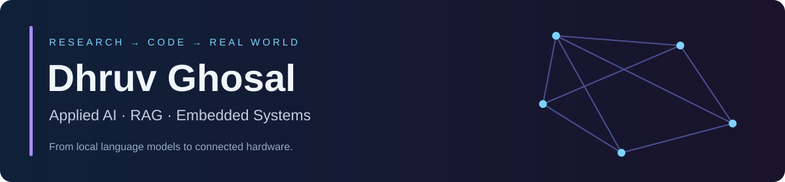

<div align="center">

<br/><br/>
<a href="https://www.linkedin.com/in/dhruv-ghosal-841353247/"></a>
<a href="https://github.com/Dhruvhash?tab=repositories"></a>
</div>

```console
dhruv@dev:~$ whoami
> Computer Science @ MSIT | Applied AI & Embedded Systems

dhruv@dev:~$ cat focus.txt
> RAG pipelines. Local LLMs. Connected hardware.
> Turning research questions into working systems.

dhruv@dev:~$ ./status
> Building, experimenting, and following the data.
```

## ⚡ Quick hits

<table><tr><td width="60%" valign="top">

**Software that thinks. Hardware that responds.**

🔬 **4 published papers** — AIoT, privacy, federated learning, and image forensics.

✈️ **AAI software internship** — an AI assistant for aviation notices.

🤖 **Local AI + RAG** — semantic search and conversational applications.

🔌 **Embedded systems** — ESP32, FreeRTOS, MQTT, and sensor integration.

🎓 **B.Tech CSE, MSIT** — Class of 2028.

</td><td width="40%" valign="top">

**How I like to build**

```text
01  Understand the problem
02  Read the research
03  Build a prototype
04  Measure what works
05  Iterate
```

Curious about the whole system—from the model to the API to the sensor.

</td></tr></table>

## 🛠️ Languages & tools

<p align="center"></p>
<p align="center">


</p>

## 🚀 Featured builds

<table><tr><td width="50%" valign="top">

### ✈️ AeroMind AI

**An aviation-focused RAG assistant.**

Ingests NOTAM bulletins, decodes aviation shorthand, and answers questions using retrieved source context.

`Python` `FastAPI` `React` `ChromaDB`

**[Explore repository](https://github.com/Dhruvhash/NOTAM-AAI-RAG-Assistant)**

</td><td width="50%" valign="top">

### 🧠 HireWise AI

**Chat with a resume using local AI.**

Combines semantic retrieval with locally hosted language models to answer questions about resume content.

`Ollama` `LangChain` `ChromaDB` `Flask`

**[Explore repository](https://github.com/Dhruvhash/hirewise-ai)**

</td></tr><tr><td width="50%" valign="top">

### 🦾 Pick-and-Place Robotic Arm

**Software meets motion.**

A four-axis Arduino robotic arm that controls servo motors for automated pick-and-place sequences.

`Arduino Uno` `C++` `Servo control`

**[Explore repository](https://github.com/Dhruvhash/ROBOTIC-ARM-)**

</td><td width="50%" valign="top">

### 🌱 Hardware lab

**Explorations in sensing and automation.**

- [Air-quality monitoring](https://github.com/Dhruvhash/AQI-MONITORING)
- [Soil monitoring](https://github.com/Dhruvhash/IOT-Basesd-soil-monitoring-system-)
- [RFID attendance system](https://github.com/Dhruvhash/RFID-ATTENDANCE-SYSTEM)

`Sensors` `IoT` `Embedded systems`

</td></tr></table>

## 🔬 Research interests

**Useful AI. Trustworthy data. Connected systems.**

My published work explores AIoT for hydroponics and aeroponics, differentially private climate forecasting, blockchain-enabled federated learning, and vision-transformer image forensics.

<details>
<summary><b>Explore my research & experience</b></summary>

### Published research themes

| Area | Focus |
| :--- | :--- |
| **AIoT agriculture** | Multi-sensor monitoring, automation, and computer vision for controlled-environment farming |
| **Private climate forecasting** | Attention-based LSTM, DP-SGD, and blockchain-backed data integrity |
| **Federated learning** | Blockchain-enabled collaborative learning for digital metrology |
| **Image forensics** | Vision transformers with FFT/DCT frequency-domain analysis |

### Experience

- **Airports Authority of India · IT / Software Intern · Jun–Jul 2026:** Built an AI NOTAM assistant and prepared a mentor-approved development roadmap.
- **ElevanceSkills · IoT Intern · May–Jun 2026:** Built and simulated an ESP32 patient-monitoring system with MQTT telemetry, medication alerts, and offline buffering.
- **Hardware & robotics:** Hardware / Robotics Lead at Melerigamy Teach Group, Hardware Project Committee at IEEE MSIT, and former hardware member of Eyantra MSIT.

</details>

---

<div align="center">

### Have an interesting problem? Let's build.

Open to applied AI, research, embedded-systems collaborations, and part-time remote opportunities.

**[Connect on LinkedIn](https://www.linkedin.com/in/dhruv-ghosal-841353247/)**

</div>

